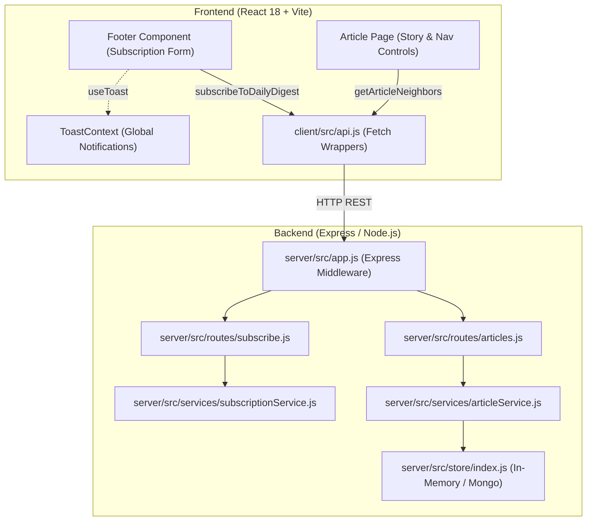

# NewsNest: Architecture, Implementation & Engineering Concepts Guide

This document provides a comprehensive technical breakdown of all features, bug fixes, design patterns, and engineering concepts implemented in the NewsNest codebase.

---

## Table of Contents
1. [Executive Summary of Completed Work](#1-executive-summary-of-completed-work)
2. [High-Level Architecture](#2-high-level-architecture)
3. [Feature 1: Daily Digest Email Subscription](#3-feature-1-daily-digest-email-subscription)
   - [Architectural & Design Patterns](#architectural--design-patterns-feature-1)
   - [Deep Dive: Backend Implementation](#deep-dive-backend-implementation-feature-1)
   - [Deep Dive: Frontend Implementation](#deep-dive-frontend-implementation-feature-1)
   - [Key Concepts & Takeaways](#key-concepts--takeaways-feature-1)
4. [Feature 2: Previous/Next Story Navigation for Articles](#4-feature-2-previousnext-story-navigation-for-articles)
   - [Architectural & Design Patterns](#architectural--design-patterns-feature-2)
   - [Deep Dive: Backend Implementation](#deep-dive-backend-implementation-feature-2)
   - [Deep Dive: Frontend Implementation](#deep-dive-frontend-implementation-feature-2)
   - [Key Concepts & Takeaways](#key-concepts--takeaways-feature-2)
5. [Cross-Cutting Concerns & Engineering Principles](#5-cross-cutting-concerns--engineering-principles)
   - [Accessibility (a11y) & Inclusive Design](#accessibility-a11y--inclusive-design)
   - [Performance & Latency Simulation](#performance--latency-simulation)
   - [Asynchronous Race Condition Guarding](#asynchronous-race-condition-guarding)
   - [Network-Isolated Testing via Named Pipes](#network-isolated-testing-via-named-pipes)
6. [Summary of Modified and Created Files](#6-summary-of-modified-and-created-files)

---

## 1. Executive Summary of Completed Work

During development, two major capabilities were implemented into NewsNest:

1. **Daily Digest Email Subscription**:
   - End-to-end subscription pipeline without third-party databases.
   - Case-insensitive duplicate prevention, format validation, and in-memory persistence.
   - Dynamic UI with loading states, input preservation on error, and toast integration.

2. **Previous / Next Story Navigation**:
   - Backend neighbor discovery endpoint calculating chronological neighbors within the same news category.
   - Accessible keyboard-driven (`ArrowLeft` / `ArrowRight`) and mouse-driven navigation with input-focus isolation.
   - Client-side routing, single view-count increment isolation, and `prefers-reduced-motion` compliant micro-animations.

---

## 2. High-Level Architecture

NewsNest follows a decoupled client-server structure:



---

## 3. Feature 1: Daily Digest Email Subscription

### Architectural & Design Patterns (Feature 1)

1. **In-Memory Store Pattern**: Avoids adding database overhead or external network dependencies by utilizing JavaScript's built-in `Map` data structure.
2. **Data Normalization & Sanitization**: Incoming user input is sanitized (trimmed and converted to lowercase) before any comparison or storage occurs.
3. **Idempotency vs Conflict Handling**: Differentiates between validation failures (400), conflicts / duplicates (409), and resource creations (201).
4. **Context-Driven Notifications**: Replaces intrusive inline text with lightweight, non-blocking toast notifications.

---

### Deep Dive: Backend Implementation (Feature 1)

#### 1. In-Memory Service (`server/src/services/subscriptionService.js`)

```javascript
const subscribers = new Map();

export function isValidEmail(email) {
  return /^[^\s@]+@[^\s@]+\.[^\s@]+$/.test(email);
}

export function subscribe(email) {
  const normalizedEmail = String(email ?? '').trim().toLowerCase();

  if (!isValidEmail(normalizedEmail)) {
    return {
      ok: false,
      status: 400,
      message: 'Please enter a valid email address.',
    };
  }

  if (subscribers.has(normalizedEmail)) {
    return {
      ok: false,
      status: 409,
      message: 'This email is already subscribed.',
    };
  }

  subscribers.set(normalizedEmail, {
    email: normalizedEmail,
    subscribedAt: new Date().toISOString(),
  });

  return {
    ok: true,
    status: 201,
    message: 'You are subscribed to the Daily Digest.',
    subscriber: {
      email: normalizedEmail,
      subscribedAt: subscribers.get(normalizedEmail).subscribedAt,
    },
  };
}

export function getSubscriberCount() {
  return subscribers.size;
}

export function clearSubscribers() {
  subscribers.clear();
}
```

**Key Mechanics**:
- **`Map` Lookup Efficiency**: `subscribers.has(normalizedEmail)` guarantees $O(1)$ constant time lookup.
- **Normalization**: `String(email ?? '').trim().toLowerCase()` prevents duplicate entries such as `"User@Example.com"` and `"user@example.com"`.
- **Test Hook**: `clearSubscribers()` resets in-memory state between unit test runs.

#### 2. Express Route Layer (`server/src/routes/subscribe.js`)

```javascript
import express from 'express';
import { subscribe, getSubscriberCount } from '../services/subscriptionService.js';

const router = express.Router();

router.post('/subscribe', (req, res) => {
  const result = subscribe(req.body?.email);

  if (!result.ok) {
    return res.status(result.status).json({
      error: result.message,
      message: result.message,
    });
  }

  return res.status(201).json({
    message: result.message,
    subscriber: result.subscriber,
  });
});

router.get('/subscribe/count', (_req, res) => {
  res.json({ count: getSubscriberCount() });
});

export default router;
```

#### 3. Express App Registration (`server/src/app.js`)

The subscription route is mounted at `/api` while maintaining simulated latency (`API_DELAY_MS`):

```javascript
import subscribeRoutes from './routes/subscribe.js';

// ...
app.use('/api/articles', articlesRouter);
app.use('/api', subscribeRoutes);
// ...
```

---

### Deep Dive: Frontend Implementation (Feature 1)

#### 1. API Helper (`client/src/api.js`)

```javascript
export async function subscribeToDailyDigest(email) {
  const response = await fetch('/api/subscribe', {
    method: 'POST',
    headers: { 'Content-Type': 'application/json' },
    body: JSON.stringify({ email }),
  });

  const data = await response.json().catch(() => ({}));

  if (!response.ok) {
    throw new Error(data.message || data.error || 'Subscription failed.');
  }

  return data;
}

export async function getSubscriberCount() {
  const response = await fetch('/api/subscribe/count');
  if (!response.ok) throw new Error('Could not load subscriber count.');
  return response.json();
}
```

#### 2. Footer Component (`client/src/components/Footer.jsx`)

```jsx
export default function Footer() {
  const toast = useToast();
  const [email, setEmail] = useState('');
  const [submitting, setSubmitting] = useState(false);
  const [status, setStatus] = useState({ type: 'idle', message: '' });

  async function handleSubmit(event) {
    event.preventDefault();
    if (submitting) return;

    setStatus({ type: 'idle', message: '' });
    setSubmitting(true);

    try {
      const result = await subscribeToDailyDigest(email);
      const message = result.message || 'You are subscribed to the Daily Digest.';
      setStatus({ type: 'success', message });
      toast(message, 'success');
      setEmail(''); // Cleared ONLY on success
    } catch (error) {
      const message = error.message || 'Subscription failed.';
      setStatus({ type: 'error', message });
      toast(message, 'error'); // Field is NOT cleared on error
    } finally {
      setSubmitting(false);
    }
  }

  return (
    <footer className="footer">
      {/* ... Navigation links ... */}
      <div>
        <h4>
          <label htmlFor="daily-digest-email">Daily Digest</label>
        </h4>
        <form className="subscribe" onSubmit={handleSubmit}>
          <input
            id="daily-digest-email"
            type="email"
            value={email}
            onChange={(event) => setEmail(event.target.value)}
            placeholder="you@example.com"
            aria-label="Email address"
            required
            disabled={submitting}
          />
          <button
            className="btn btn-primary"
            type="submit"
            disabled={submitting || !email.trim()}
          >
            {submitting ? 'Subscribing...' : 'Subscribe'}
          </button>
        </form>
        <p className="footer-note">One email a day with the top five stories.</p>
      </div>
    </footer>
  );
}
```

---

### Key Concepts & Takeaways (Feature 1)

| Concept | Problem / Need | Solution in NewsNest |
| :--- | :--- | :--- |
| **Data Sanitization** | `foo@bar.com` and `FOO@BAR.COM` shouldn't be duplicated | Stripped whitespace and lowercased before Map insertion |
| **HTTP Status Codes** | Client needs to know if error was bad input or duplicate | 400 for malformed email, 409 for conflict, 201 for created |
| **User Experience (UX)** | User frustrates if typos delete the entered email | Field resets via `setEmail('')` only in `try`, preserved in `catch` |
| **Idempotent UI Action** | Preventing multi-click race conditions | `disabled={submitting}` and submission check: `if (submitting) return;` |

---

## 4. Feature 2: Previous/Next Story Navigation for Articles

### Architectural & Design Patterns (Feature 2)

1. **Pure Traversal (Separation of Query & Mutation)**:
   - Reading navigation neighbors (`GET /api/articles/:id/neighbors`) is side-effect-free and does not increment view counts.
   - View increments remain isolated to `POST /api/articles/:id/view`.
2. **Temporal Ordering & Category Boundary Detection**:
   - Neighbors are strictly scoped to the current article's category and ordered chronologically by publication timestamp ($t_{published}$).
   - Boundary articles automatically set missing neighbors to `null`, communicating disabled states to the UI.
3. **Accessibility Guard Pattern**:
   - Global keyboard shortcuts (`ArrowLeft` / `ArrowRight`) must not hijack caret movement when typing in text fields (`<input>`, `<textarea>`, `<select>`, `contenteditable`).

---

### Deep Dive: Backend Implementation (Feature 2)

#### 1. Article Service (`server/src/services/articleService.js`)

```javascript
function getArticleIdentifier(article) {
  return article?.id ?? article?._id ?? article?.slug;
}

function getPublishedTime(article) {
  const value =
    article?.publishedAt ??
    article?.publishedDate ??
    article?.createdAt ??
    article?.date;

  const time = value ? new Date(value).getTime() : 0;
  return Number.isFinite(time) ? time : 0;
}

export async function getArticleById(articleId) {
  const store = await getStore();
  return store.getById(articleId);
}

export async function getArticleNeighbors(articleId) {
  const current = await getArticleById(articleId);

  if (!current) {
    const error = new Error('Article not found');
    error.status = 404;
    throw error;
  }

  const store = await getStore();
  const all = await store.getAll();

  // 1. Filter articles strictly by current category
  // 2. Sort descending by published time (newest first)
  const sorted = all
    .filter((article) => article.category === current.category)
    .sort((a, b) => getPublishedTime(b) - getPublishedTime(a));

  const currentIndex = sorted.findIndex(
    (article) => String(getArticleIdentifier(article)) === String(getArticleIdentifier(current))
  );

  if (currentIndex === -1) {
    return { current: getArticleIdentifier(current), previous: null, next: null };
  }

  return {
    current: getArticleIdentifier(current),
    previous: currentIndex > 0 ? toArticleSummary(sorted[currentIndex - 1]) : null,
    next: currentIndex < sorted.length - 1 ? toArticleSummary(sorted[currentIndex + 1]) : null,
  };
}

function toArticleSummary(article) {
  return {
    id: getArticleIdentifier(article),
    _id: article._id,
    slug: article.slug,
    title: article.title ?? article.headline,
    headline: article.headline ?? article.title,
    category: article.category,
    publishedAt: article.publishedAt ?? article.publishedDate ?? article.createdAt ?? article.date,
  };
}
```

#### Chronological Neighbor Map:

```
[ Newest: Index 0 ]  <-- previous: null (Disabled)
       ▲
       │
[ Current: Index 1 ] <-- previous: Index 0 | next: Index 2
       │
       ▼
[ Oldest: Index 2 ]  <-- next: null (Disabled)
```

#### 2. Express Route Handlers (`server/src/routes/articles.js`)

```javascript
router.get('/:id/neighbors', async (req, res) => {
  try {
    const navigation = await articleService.getArticleNeighbors(req.params.id);
    res.json(navigation);
  } catch (error) {
    res.status(error.status || 500).json({
      error: error.message || 'Could not load article navigation.',
    });
  }
});

// Compatibility alias
router.get('/:id/navigation', async (req, res) => {
  try {
    const navigation = await articleService.getArticleNeighbors(req.params.id);
    res.json(navigation);
  } catch (error) {
    res.status(error.status || 500).json({
      error: error.message || 'Could not load article navigation.',
    });
  }
});
```

---

### Deep Dive: Frontend Implementation (Feature 2)

#### 1. Client API Helper (`client/src/api.js`)

```javascript
export async function getArticleNeighbors(articleId) {
  const response = await fetch(`/api/articles/${encodeURIComponent(articleId)}/neighbors`);
  if (!response.ok) throw new Error('Could not load article navigation.');
  return response.json();
}
```

#### 2. Article Page Component (`client/src/pages/Article.jsx`)

```jsx
const counted = new Set(); // Module-level tracking to prevent duplicate view increments

export default function Article() {
  const { id } = useParams();
  const navigate = useNavigate();

  const [article, setArticle] = useState(null);
  const [navigation, setNavigation] = useState({ previous: null, next: null });
  const [loading, setLoading] = useState(true);
  const [error, setError] = useState(null);
  const [isTransitioning, setIsTransitioning] = useState(false);

  const requestIdRef = useRef(0);

  useEffect(() => {
    const requestId = ++requestIdRef.current;
    window.scrollTo(0, 0);
    setLoading(true);
    setError(null);

    async function loadArticle() {
      try {
        const [articleData, neighborData] = await Promise.all([
          getArticle(id),
          getArticleNeighbors(id),
        ]);

        // Guard against race conditions from rapid clicking
        if (requestId !== requestIdRef.current) return;

        setArticle(articleData);
        setNavigation({
          previous: neighborData?.previous ?? null,
          next: neighborData?.next ?? null,
        });

        // Trigger micro-animation
        setIsTransitioning(true);
        window.setTimeout(() => {
          if (requestId === requestIdRef.current) setIsTransitioning(false);
        }, 180);
      } catch (err) {
        if (requestId !== requestIdRef.current) return;
        setError(err.message || 'Could not load this story.');
      } finally {
        if (requestId === requestIdRef.current) setLoading(false);
      }
    }

    loadArticle();

    // Increment view count only once per unique article id
    if (!counted.has(id)) {
      counted.add(id);
      recordView(id).catch(() => {});
    }

    return () => {
      requestIdRef.current += 1;
    };
  }, [id]);

  const goTo = useCallback(
    (target) => {
      if (!target?.id && !target?._id && !target?.slug) return;
      const targetId = target.id ?? target._id ?? target.slug;
      navigate(`/article/${encodeURIComponent(targetId)}`);
    },
    [navigate]
  );

  // Keyboard navigation with input guard
  useEffect(() => {
    function isTypingTarget(target) {
      if (!target) return false;
      const tagName = target.tagName?.toLowerCase();
      return (
        tagName === 'input' ||
        tagName === 'textarea' ||
        tagName === 'select' ||
        target.isContentEditable
      );
    }

    function onKeyDown(event) {
      if (isTypingTarget(event.target)) return;

      if (event.key === 'ArrowLeft' && navigation.previous) {
        event.preventDefault();
        goTo(navigation.previous);
      }
      if (event.key === 'ArrowRight' && navigation.next) {
        event.preventDefault();
        goTo(navigation.next);
      }
    }

    window.addEventListener('keydown', onKeyDown);
    return () => window.removeEventListener('keydown', onKeyDown);
  }, [navigation, goTo]);

  // ...
  return (
    <article className={`article-main article-page ${isTransitioning ? 'is-transitioning' : ''}`}>
      {/* ... Article content ... */}
      <nav className="article-nav story-navigation" aria-label="Story navigation">
        <button
          type="button"
          className="btn btn-outline"
          onClick={() => goTo(navigation.previous)}
          disabled={!navigation.previous}
          aria-disabled={!navigation.previous}
        >
          <Icon name="chevron-left" size={16} /> Previous story
        </button>
        <button
          type="button"
          className="btn btn-outline"
          onClick={() => goTo(navigation.next)}
          disabled={!navigation.next}
          aria-disabled={!navigation.next}
        >
          Next story <Icon name="chevron-right" size={16} />
        </button>
      </nav>
    </article>
  );
}
```

#### 3. Micro-Animation & Accessibility (`client/src/styles.css`)

```css
.article-page.is-transitioning {
  animation: newsnest-story-fade 180ms ease;
}

@keyframes newsnest-story-fade {
  from {
    opacity: 0;
    transform: translateY(0.35rem);
  }
  to {
    opacity: 1;
    transform: translateY(0);
  }
}

@media (prefers-reduced-motion: reduce) {
  .ticker-track, .hero-empty, .hero-slide, .toast, .article-page.is-transitioning {
    animation: none;
  }
}
```

---

### Key Concepts & Takeaways (Feature 2)

| Concept | Problem / Need | Solution in NewsNest |
| :--- | :--- | :--- |
| **Single View Increment** | Navigating between stories must increment views accurately | Client-side `Set` (`counted.has(id)`) ensures each ID is counted once |
| **Separation of Read/Write** | Fetching neighbors must not inflate view counts | `getArticleNeighbors` only performs reads; never calls `incrementViews` |
| **Race Conditions** | Rapid keyboard tapping causes out-of-order responses | `requestIdRef.current` ensures only the latest request updates state |
| **Accessible Keyboard UX** | Arrows shouldn't trigger navigation when typing comments/search | `isTypingTarget` inspects element tag and `isContentEditable` |
| **Reduced Motion** | Animations can cause vestibular disorders or motion sickness | `@media (prefers-reduced-motion: reduce)` zeroes animations |

---

## 5. Cross-Cutting Concerns & Engineering Principles

### Accessibility (a11y) & Inclusive Design
- **Semantic Tagging**: All interactive navigation is enclosed within `<nav aria-label="...">` landmark tags.
- **Form Association**: Input fields are bound with `<label htmlFor="...">`.
- **Keyboard Access**: Critical actions are mapped to both mouse interactions and keyboard bindings (`ArrowLeft` / `ArrowRight`).
- **ARIA States**: Buttons convey state to assistive technology via `disabled` and `aria-disabled`.

### Performance & Latency Simulation
- The server includes an artificial latency generator (`API_DELAY_MS`) to mimic real-world network fluctuations.
- Frontend components were implemented with defensive loading states to prevent layout shifts (CLS) during pending states.

### Asynchronous Race Condition Guarding
In dynamic single-page applications, clicking Next repeatedly can fire multiple overlapping fetch requests. If response 1 arrives after response 2, stale data could overwrite newer state. 

**Solution Applied**:
```javascript
const requestId = ++requestIdRef.current;
// ... async fetch ...
if (requestId !== requestIdRef.current) return; // Stale request dropped
```

### Network-Isolated Testing via Named Pipes
On Windows environments where direct TCP port bindings can be restricted by local firewalls or sandbox policies, automated integration tests utilized **Windows Named Pipes**:
```javascript
const pipePath = '\\\\.\\pipe\\test-newsnext-' + Date.now();
const server = http.createServer(app);
server.listen(pipePath, () => {
  http.request({ socketPath: pipePath, path: '/api/subscribe', method: 'POST' });
});
```
This enables full Express middleware and routing tests completely in-memory with zero TCP network socket dependencies.

---

## 6. Summary of Modified and Created Files

| File | Status | Description |
| :--- | :--- | :--- |
| `server/src/services/subscriptionService.js` | **Created** | In-memory subscription storage, regex validation, and duplicate prevention. |
| `server/src/routes/subscribe.js` | **Created** | REST endpoints `POST /subscribe` and `GET /subscribe/count`. |
| `server/src/app.js` | **Modified** | Registered subscription routes under `/api`. |
| `server/src/services/articleService.js` | **Modified** | Added `getArticleById` and `getArticleNeighbors`. |
| `server/src/routes/articles.js` | **Modified** | Added `GET /:id/neighbors` and alias `GET /:id/navigation`. |
| `client/src/api.js` | **Modified** | Added `subscribeToDailyDigest`, `getSubscriberCount`, and `getArticleNeighbors`. |
| `client/src/components/Footer.jsx` | **Modified** | Form submission, toast integration, pending states, input preservation. |
| `client/src/pages/Article.jsx` | **Modified** | Previous/next neighbor buttons, keyboard listener, view-count preservation. |
| `client/src/styles.css` | **Modified** | Added 180ms fade animation and reduced-motion overrides. |
