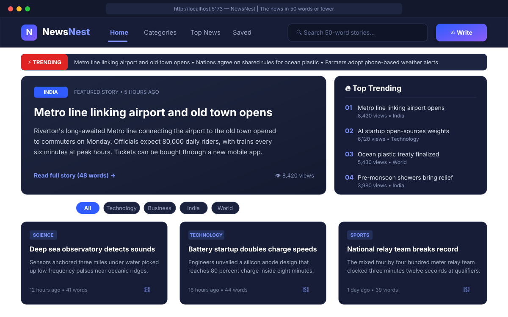
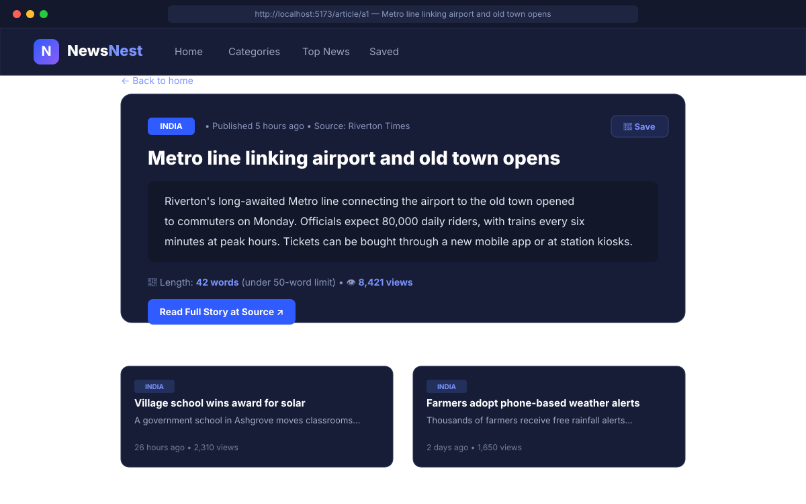
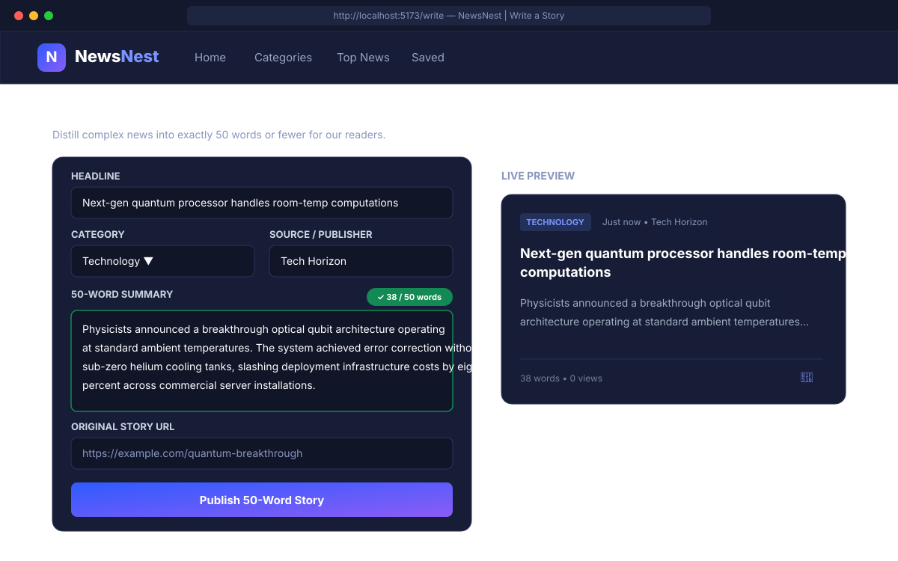
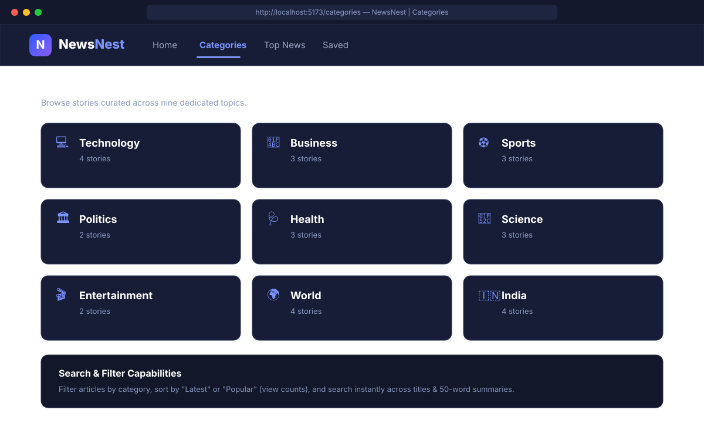

# NewsNest

**[English](README.md) | [हिन्दी](README.hi.md)**

**50 शब्दों या उससे कम में समाचार।**

NewsNest एक संक्षिप्त समाचार (news-in-short) ऐप्लिकेशन है। प्रत्येक समाचार एक कार्ड के रूप में प्रस्तुत किया जाता है जिसमें एक शीर्षक (headline), अधिकतम 50 शब्दों का सार (summary), और पूरे लेख का बाहरी लिंक शामिल होता है। इसमें एक फ़ीचर्ड कैरोसेल, ट्रेंडिंग सूची, श्रेणीवार समाचार, त्वरित खोज, बाद में पढ़ने के लिए बुकमार्क और स्वयं का समाचार लिखने की सुविधा उपलब्ध है।

यह ऐप्लिकेशन MERN स्टैक (MongoDB, Express, React, Node) के साथ बनाया गया है। यह डिफ़ॉल्ट रूप से **बिना किसी डेटाबेस या लॉगिन के** सीधे इन-मेमोरी मोड में चलता है, ताकि आप केवल दो कमांड्स चलाकर इसे तुरंत शुरू कर सकें।

> **हैक डे प्रोजेक्ट (Hack Day project):** यह रिपॉजिटरी जानबूझकर अधूरी रखी गई है: कुछ चीज़ें टूटी हुई हैं और कुछ सुविधाएँ गायब हैं। प्रत्येक कमी एक GitHub समस्या (Issue) के रूप में सूचीबद्ध है। कोई एक समस्या चुनें, उसे ठीक करें और पुल रिक्वेस्ट (PR) भेजें। विस्तृत जानकारी के लिए [CONTRIBUTING.md](CONTRIBUTING.md) देखें।

---

## स्क्रीनशॉट्स (Screenshots)

### 1. होम डैशबोर्ड और ट्रेंडिंग कैरोसेल
ब्रेकिंग न्यूज़ टिकर, मुख्य फ़ीचर्ड समाचार, शीर्ष ट्रेंडिंग सूची, और फ़िल्टर किए जा सकने वाले समाचार कार्ड।



---

### 2. समाचार विस्तार और संबंधित ख़बरें
रीडिंग मेट्रिक्स, मूल स्रोत लिंक, एक-क्लिक बुकमार्क और श्रेणी से संबंधित अन्य समाचारों के साथ 50 शब्दों का पूरा कार्ड।



---

### 3. समाचार लेखन और लाइव 50-शब्द काउंटर
वास्तविक समय (real-time) शब्द गणना, 50 शब्दों की सीमा जांच, और साथ-साथ लाइव कार्ड पूर्वावलोकन (preview) के साथ नया समाचार लिखें।



---

### 4. श्रेणियां और खोज
नौ अलग-अलग विषयों में व्यवस्थित समाचार, त्वरित टेक्स्ट खोज और लोकप्रियता (views) के अनुसार छँटाई (sort)।



---

## मुख्य विशेषताएं (Features)

- ब्रेकिंग न्यूज़ टिकर और फ़ीचर्ड स्टोरी कैरोसेल
- ट्रेंडिंग न्यूज़ सूची, श्रेणी फ़िल्टर और "Load more" के साथ नवीनतम समाचार ग्रिड
- श्रेणी पृष्ठ (Category pages), टॉप न्यूज़ रैंकिंग, और संबंधित समाचारों के साथ स्टोरी पेज
- श्रेणी और सॉर्ट फ़िल्टर के साथ त्वरित खोज (Search)
- बाद में पढ़ने के लिए समाचार सेव करने की सुविधा (आपके ब्राउज़र में सुरक्षित)
- लाइव शब्द काउंटर और रीयल-टाइम पूर्वावलोकन के साथ अपनी ख़बर स्वयं लिखें
- शेयर बटन, डार्क मोड और उत्तरदायी (responsive) डिज़ाइन

---

## टेक स्टैक (Tech Stack)

| भाग | उपयोग की गई तकनीकें |
| --- | --- |
| **फ़्रंटएंड (Frontend)** | React 18, React Router, Vite |
| **बैकएंड (Backend)** | Node.js, Express |
| **डेटा (Data)** | डिफ़ॉल्ट रूप से इन-मेमोरी स्टोर। Mongoose के माध्यम से MongoDB वैकल्पिक है। |

---

## चलाने का तरीका (Run it)

इसके लिए आपके सिस्टम में **Node.js 18.11 या नया संस्करण** होना आवश्यक है।

```bash
npm install
npm run dev
```

इसके बाद अपने ब्राउज़र में **http://localhost:5173** खोलें। API बैकएंड http://localhost:5000 पर चलता है।

बस इतना ही! किसी डेटाबेस, लॉगिन, API की (key) या डॉकर (Docker) की कोई आवश्यकता नहीं है।

> यदि ऐप्लिकेशन चलाने में कोई समस्या आ रही है, तो [समस्या निवारण गाइड (Troubleshooting Guide)](docs/TROUBLESHOOTING.md) देखें।

---

### वैकल्पिक सेटिंग्स (Optional settings)

इन सेटिंग्स को बदलने के लिए `server/.env.example` की एक प्रति `server/.env` के रूप में बनाएं:

| चर (Variable) | डिफ़ॉल्ट | विवरण |
| --- | --- | --- |
| `PORT` | `5000` | API सर्वर का पोर्ट |
| `MONGO_URI` | खाली | इसे खाली छोड़ दें और NewsNest कभी किसी डेटाबेस से कनेक्ट नहीं होगा: समाचार मेमोरी में रहेंगे और सर्वर रीस्टार्ट होने पर रीसेट हो जाएंगे। केवल तभी सेट करें जब आप MongoDB का उपयोग करना चाहते हों। |
| `API_DELAY_MS` | `700` | धीमे नेटवर्क का अनुकरण करने के लिए प्रत्येक API कॉल में इस मिलीसेकंड तक का यादृच्छिक विलंब (delay) जोड़ता है। इसे बंद करने के लिए `0` सेट करें। |

---

## विस्तृत दस्तावेज़ (Documentation)

परियोजना के संपूर्ण दस्तावेज़ [`docs/`](docs/) डायरेक्टरी में उपलब्ध हैं:

- 🏛️ **[क्लाइंट-सर्वर आर्किटेक्चर (Client-Server Architecture)](docs/ARCHITECTURE.md)**: सिस्टम डिज़ाइन, घटक पदानुक्रम, डेटा प्रवाह अनुक्रम आरेख, और स्थिति प्रबंधन।
- 📡 **[REST API दस्तावेज़ (REST API Documentation)](docs/API.md)**: सभी एंडपॉइंट्स, पैरामीटर्स, अनुरोध और प्रतिक्रिया उदाहरण, और त्रुटि कोड्स।
- 🔧 **[समस्या निवारण गाइड (Troubleshooting Guide)](docs/TROUBLESHOOTING.md)**: Node संस्करण, पोर्ट विरोध, प्रॉक्सी और नेटवर्क समस्याओं का त्वरित समाधान।
- 📚 **[सीड डेटा एवं स्टोरी गाइड (Story Data & Seed Guide)](docs/SEED_DATA.md)**: डेटा स्कीमा, डायनामिक दिनांक रूपांतरण (`hoursAgo` से `publishedAt`), और नए समाचार जोड़ने के निर्देश।

---

## प्रोजेक्ट संरचना (Project layout)

```
newsnest/
  client/   React ऐप्लिकेशन (Vite)
  server/   Express API
  docs/     आर्किटेक्चर, API, समस्या निवारण और सीड गाइड
  .github/  पुल रिक्वेस्ट टेम्प्लेट
```

---

## योगदान (Contributing)

फ़ोर्क करने, ब्रांच बनाने और पुल रिक्वेस्ट खोलने के तरीके के लिए [CONTRIBUTING.md](CONTRIBUTING.md) पढ़ें।

---

## लाइसेंस (License)

[MIT](LICENSE)
