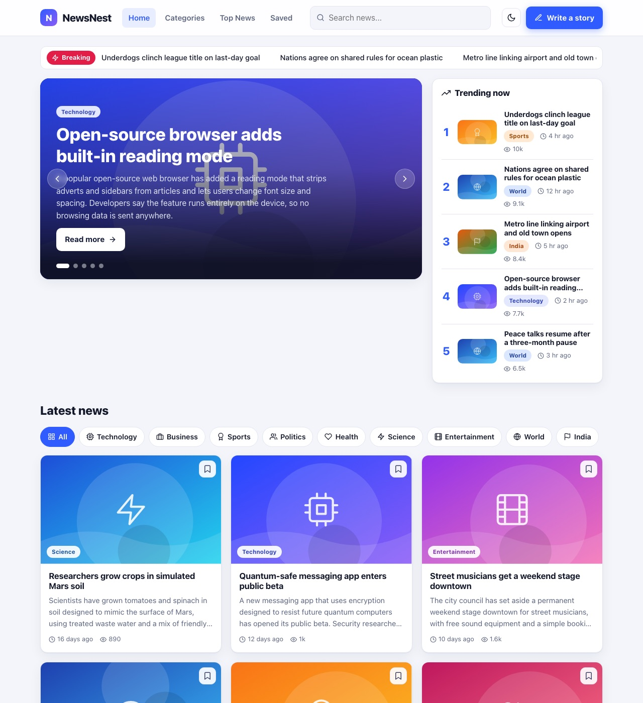
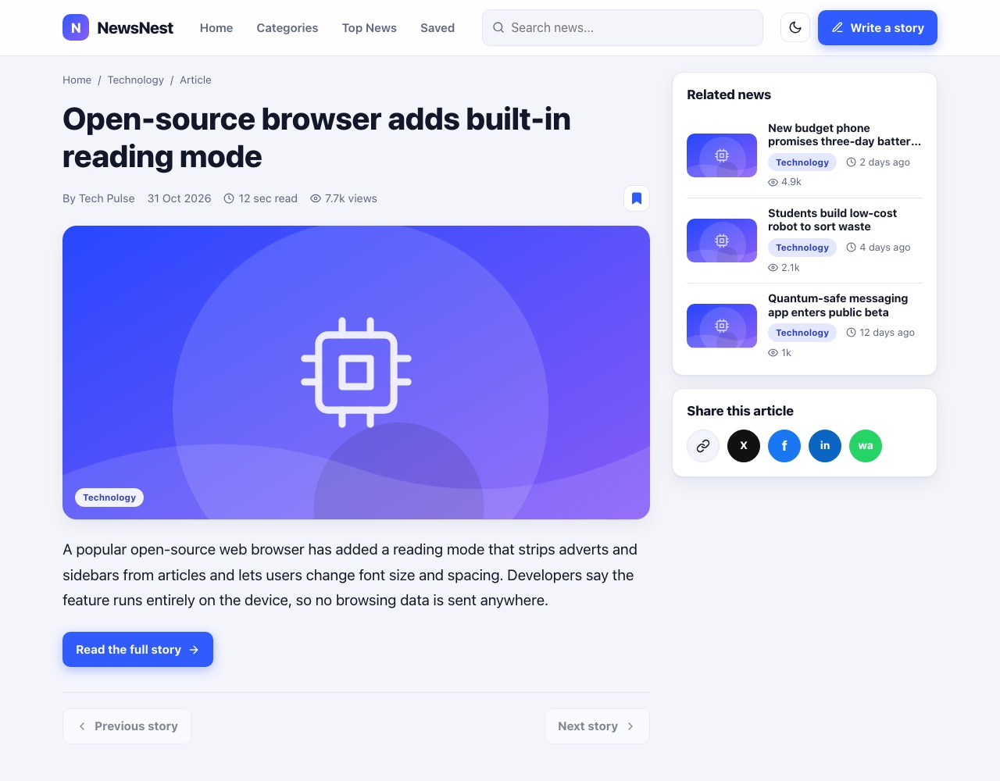
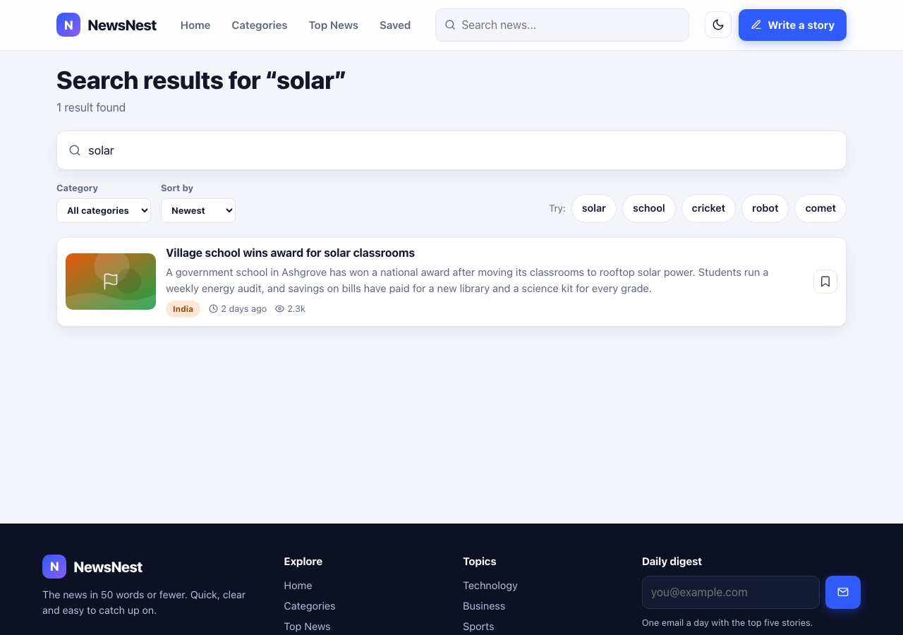
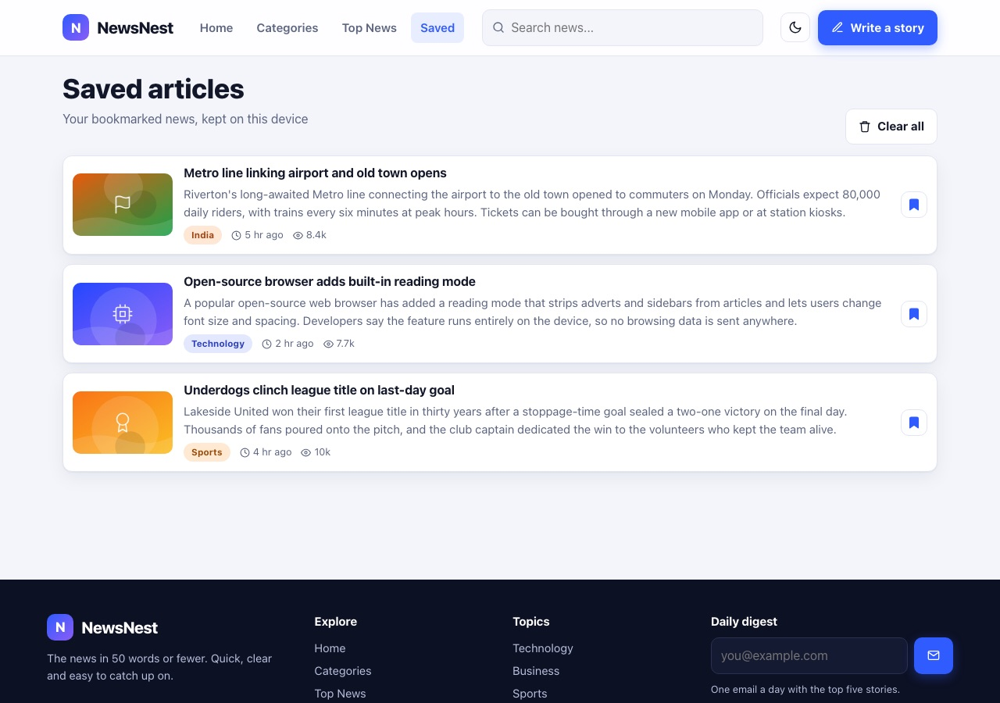

# NewsNest

**The news in 50 words or fewer.**

NewsNest is a news-in-short app. Every story is a card with a headline, a summary of at most 50 words, and a link to the full article. Browse a featured carousel and a trending list, explore by category, search, save stories for later, or write one of your own.

Built with the MERN stack (MongoDB, Express, React, Node). It runs **without any database or login** by default, so you can be up and running in two commands.

> **Hack Day project.** This repo is deliberately incomplete: some things are broken and some features are missing. Each one is a GitHub issue. Pick one, fix it, and open a pull request. See [CONTRIBUTING.md](CONTRIBUTING.md).

## Screenshots

| Home | Story |
| --- | --- |
|  |  |
| **Search** | **Saved** |
|  |  |

## Features

- Breaking-news ticker and a featured story carousel
- Trending list, latest news grid with category filters and "Load more"
- Category pages, a Top News ranking and story pages with related news
- Search with category and sort filters
- Save stories to read later (stored in your browser)
- Write your own story, with a live word counter and preview
- Share buttons, dark mode and a responsive layout

## Tech stack

| Part | What we use |
| --- | --- |
| Frontend | React 18, React Router, Vite |
| Backend | Node.js, Express |
| Data | In-memory store by default. MongoDB through Mongoose is optional. |

## Run it

You need **Node.js 18.11 or newer**.

```bash
npm install
npm run dev
```

Then open **http://localhost:5173**. The API runs on http://localhost:5000.

That is all. No database, login, API key or Docker needed.

### Optional settings

Copy `server/.env.example` to `server/.env` to change any of these:

| Variable | Default | What it does |
| --- | --- | --- |
| `PORT` | `5000` | Port for the API |
| `MONGO_URI` | empty | Leave empty and NewsNest never connects to a database: stories live in memory and reset when the server restarts. Set it only if you want to store stories in MongoDB. |
| `API_DELAY_MS` | `700` | Adds a random delay of up to this many milliseconds to every API call, to imitate a slow network. Set `0` to turn it off. |

## Project layout

```
newsnest/
  client/   React app (Vite)
  server/   Express API
  .github/  Pull request template
```

## Contributing

Read [CONTRIBUTING.md](CONTRIBUTING.md) for how to fork, branch and open a pull request.

## License

[MIT](LICENSE)
