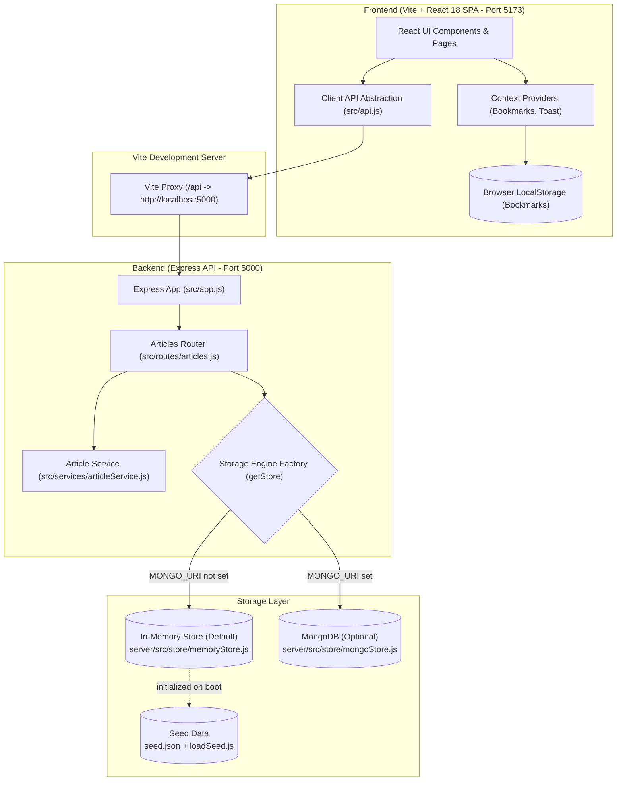
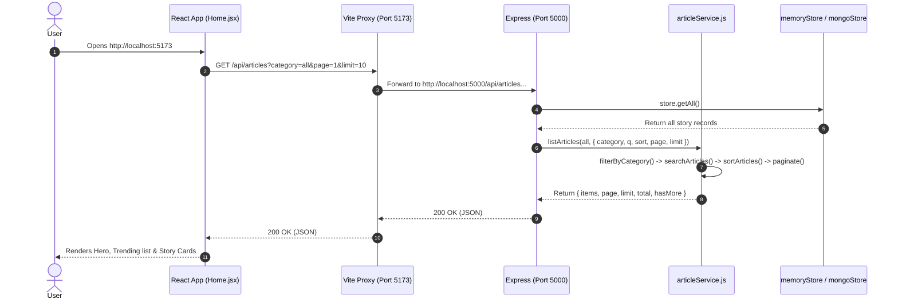
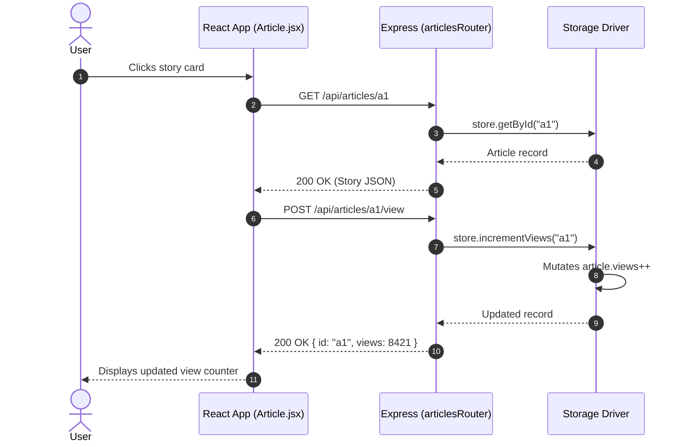
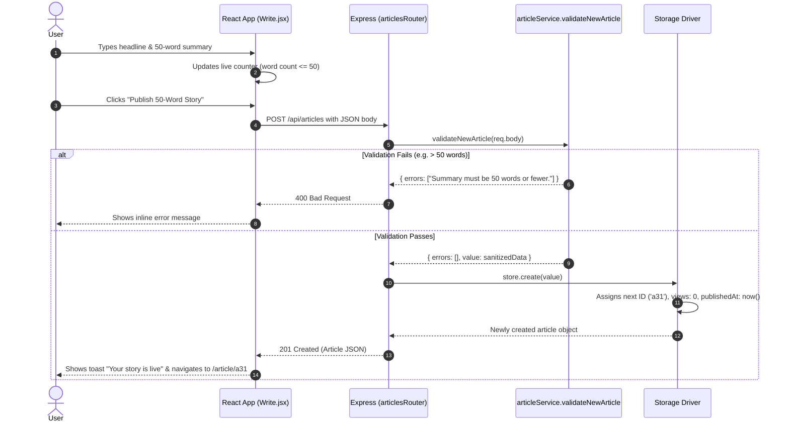

# NewsNest Client-Server Architecture & Data Flow

This document details the architectural design, component hierarchy, data flow, and state management patterns of NewsNest.

---

## 1. High-Level System Architecture

NewsNest is built on a decoupled client-server architecture. The frontend is a Single-Page Application (SPA) powered by React and Vite, while the backend is an Express REST API with an abstracted dual-engine storage layer.



---

## 2. Component Hierarchy & Responsibilities

### 2.1 Frontend (`client/src`)

The client is organized into modular pages, components, context providers, and hooks:

```
client/src/
├── api.js              # Centralized fetch wrapper for /api calls
├── App.jsx             # Root layout: Navbar, Route registry, Footer
├── main.jsx            # React root mount with BrowserRouter & Context Providers
├── styles.css          # Core CSS variables, light/dark themes, grid system
├── components/
│   ├── ArticleCard.jsx     # Card rendering 50-word story, category badge, bookmark action
│   ├── ArticleRow.jsx      # Compact row view used in Top News and search lists
│   ├── BookmarkButton.jsx  # Toggle button connected to BookmarksContext
│   ├── CategoryChips.jsx   # Filter pills (All, India, Technology, etc.)
│   ├── CategoryTiles.jsx   # Grid of category cards with live story counters
│   ├── Footer.jsx          # App footer with links and attribution
│   ├── Hero.jsx            # Featured story carousel on the homepage
│   ├── Icon.jsx            # SVG icon primitives (search, bookmark, sun, moon, etc.)
│   ├── Navbar.jsx          # Sticky top bar with search input, navigation & write button
│   ├── ShareButtons.jsx    # Web Share API and clipboard copy utility
│   ├── Thumb.jsx           # Dynamic category gradient placeholder thumbnails
│   ├── Ticker.jsx          # Breaking news marquee ticker
│   └── TrendingList.jsx    # Top trending sidebar list ordered by views
├── context/
│   ├── BookmarksContext.jsx # Global bookmark IDs state and toggle actions
│   └── ToastContext.jsx     # Ephemeral toast notifications (success/error alerts)
├── hooks/
│   ├── useBookmarks.js     # Syncs bookmark IDs with browser localStorage
│   └── useCategories.js    # Fetches and caches category counts from /api/categories
└── pages/
    ├── Article.jsx         # Full story view, metrics, source link, and related stories
    ├── Categories.jsx      # Category overview and category-filtered feed
    ├── Home.jsx            # Main dashboard: Ticker, Hero, Trending, Categories & Feed
    ├── Saved.jsx           # Saved stories list loaded from local storage IDs
    ├── Search.jsx          # Search results with live text search and sort controls
    ├── TopNews.jsx         # Ranked list of stories sorted by view count
    └── Write.jsx           # Submission form with live word counter & card preview
```

### 2.2 Backend (`server/src`)

The server follows a clean layered design separating transport, business logic, and storage:

```
server/src/
├── app.js               # Express app initialization, CORS, latency middleware, router mounts
├── index.js             # Server startup entry point and port listener
├── constants.js         # Supported categories (slugs & names), MAX_WORDS (50), MAX_TITLE_LENGTH (120)
├── routes/
│   └── articles.js      # REST route handlers for /api/articles
├── services/
│   └── articleService.js# Pure business logic: filtering, searching, sorting, pagination, validation
├── store/
│   ├── index.js         # getStore() factory dynamically resolving storage driver
│   ├── memoryStore.js   # Default in-memory array storage implementation
│   └── mongoStore.js    # Optional Mongoose/MongoDB implementation
├── data/
│   ├── seed.json        # Curated mock articles with relative hoursAgo timestamps
│   └── loadSeed.js      # Transforms hoursAgo into dynamic ISO publishedAt dates
└── utils/
    └── wordCount.js     # Regex-based word counter matching frontend behavior
```

---

## 3. Storage Layer Pattern

NewsNest uses the **Repository / Storage Driver Pattern**. Business logic and route handlers never interact directly with database drivers or arrays. Instead, they interact with an identical contract returned by `getStore()`:

| Method | Signature | Description |
|---|---|---|
| `getAll()` | `() => Promise<Article[]>` | Retrieves all articles in the system. |
| `getById(id)` | `(id: string) => Promise<Article \| null>` | Retrieves a single article by its unique ID. |
| `create(data)` | `(data: NewArticleInput) => Promise<Article>` | Persists a new article and assigns an ID, zero views, and timestamp. |
| `incrementViews(id)` | `(id: string) => Promise<Article \| null>` | Atomically increments view count by 1 and returns updated record. |

- If `process.env.MONGO_URI` is defined, `server/src/store/index.js` dynamically imports and connects `mongoStore.js`.
- If `process.env.MONGO_URI` is omitted (the default), `memoryStore.js` is loaded synchronously without connecting to any external network or database.

---

## 4. Key Application Data Flows

### 4.1 Page Load & Article Fetching

When a user visits the homepage (`/`), the client requests featured stories, trending stories, categories, and paginated latest stories:



### 4.2 Recording Story Views

When a user navigates to an article detail page (`/article/:id`), the client registers an atomic view:



### 4.3 Submitting a Story (`/write`)



---

## 5. State Management & Persistence

| State Concern | Implementation | Persistence Mechanism |
|---|---|---|
| **Articles & Categories** | React local component state (`useState`, `useEffect`) | Fetched from Express API (`/api/articles`, `/api/categories`). |
| **Bookmarks** | Global React Context (`BookmarksProvider` via `useBookmarks.js`) | Persisted in browser `window.localStorage` under key `newsnest:bookmarks`. |
| **Notifications** | Global Toast Context (`ToastProvider` via `ToastContext.jsx`) | In-memory ephemeral queue with auto-dismiss timers. |
| **Theme (Light / Dark)**| Stored in `localStorage` and applied via `document.documentElement.dataset.theme`. | Preserved across page reloads. |
