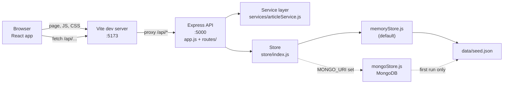

# How NewsNest fits together

NewsNest is two small apps in one repository:

- **`client/`**: a React app built and served by Vite. It only draws the page and asks the API for data.
- **`server/`**: an Express API that owns the stories and the rules (such as the 50-word limit).

`npm run dev` at the root starts both at once with `concurrently`: the API on port **5000** and Vite on port **5173**.

## The big picture



The same diagram as text:

```
Browser (React)
   │  GET /            → Vite sends index.html + the React code
   │  GET /api/...     → Vite forwards it (proxy in client/vite.config.js)
   ▼
Vite dev server :5173 ──proxy──► Express API :5000   (server/src/app.js)
                                    │
                                    ├─ routes/articles.js   reads the request, picks a status code
                                    ├─ services/articleService.js   pure functions: filter, search, sort, page, validate
                                    └─ store/index.js   chooses a store once
                                          ├─ memoryStore.js   array in memory (default)
                                          └─ mongoStore.js    MongoDB (only if MONGO_URI is set)
                                                 ▲
                                        data/seed.json + data/loadSeed.js
```

### Who does what

| Layer | Files | Job |
| --- | --- | --- |
| Pages | `client/src/pages/*.jsx` | One component per URL. Fetch data, hold state, render components |
| Components | `client/src/components/*.jsx` | Reusable pieces: cards, navbar, carousel, buttons |
| API client | `client/src/api.js` | The **only** place the client talks to the server. One small function per endpoint |
| Browser-only state | `client/src/context/`, `client/src/hooks/` | Bookmarks (saved in `localStorage`), toasts, cached categories |
| Proxy | `client/vite.config.js` | Forwards `/api/*` from port 5173 to 5000, so the browser never deals with CORS or a second port |
| HTTP layer | `server/src/app.js`, `server/src/routes/articles.js` | Middleware, URL → handler, status codes, JSON responses |
| Service layer | `server/src/services/articleService.js` | Business rules as plain functions that take an array of stories and return a result. No HTTP, no database |
| Store | `server/src/store/` | Where stories live. Four async methods: `getAll`, `getById`, `create`, `incrementViews` |

Keeping the service layer free of HTTP and storage means the same `listArticles()` works with either store, and is easy to test on its own.

## One request, step by step: loading the home page

What happens between opening http://localhost:5173 and seeing the **Latest news** cards:

1. **The browser asks Vite for the page.** Vite returns `client/index.html`, which has an empty `<div id="root">` and loads `client/src/main.jsx`.
2. **React starts.** `main.jsx` wraps the app in `BrowserRouter`, `ToastProvider` and `BookmarksProvider`, then renders `App` (`client/src/App.jsx`).
3. **The router picks the page.** `App.jsx` always renders `Navbar` and `Footer`; for the path `/` its `<Routes>` renders `Home` (`client/src/pages/Home.jsx`).
4. **Home asks for stories.** On mount, a `useEffect` in `Home` sets `loading` to `true` and calls
   `getArticles({ category: 'all', sort: 'latest', page: 1, limit: 9 })` from `client/src/api.js`.
   At the same time `Ticker`, `Hero` and `TrendingList` fire their own requests (`getTrending`, `getFeatured`).
5. **api.js builds the URL.** `getArticles` turns the options into a query string (it leaves out `category` when it is `all`) and calls `request('/articles?sort=latest&page=1&limit=9')`, which runs `fetch('/api/articles?...')`.
6. **Vite forwards it.** The request goes to port 5173, matches the `'/api'` proxy rule in `client/vite.config.js`, and is sent on to `http://localhost:5000/api/articles?...`.
7. **Express middleware runs** in the order it is registered in `server/src/app.js`:
   `cors()` → `express.json()` → the simulated-latency middleware (waits 0 to `API_DELAY_MS` ms) → `app.use('/api/articles', articlesRouter)`.
8. **The route handler runs.** `router.get('/')` in `server/src/routes/articles.js` calls `getStore()` (`server/src/store/index.js`). The first call creates the store; later calls reuse it. With no `MONGO_URI` it is `createMemoryStore()`, which loaded `seed.json` through `loadSeed()` when the server started.
9. **The store returns every story.** `store.getAll()` returns a copy of the array.
10. **The service layer does the work.** The handler passes the array and the parsed query (`page` and `limit` turned into numbers, `limit` capped at 100) to `listArticles()` in `server/src/services/articleService.js`, which runs `filterByCategory` → `searchArticles` → `sortArticles` → `paginate` and returns `{ items, page, limit, total, hasMore }`.
11. **Express replies.** `res.json(...)` sends the result with status 200, back through the Vite proxy to the browser.
12. **React renders it.** `request()` in `api.js` parses the JSON (or throws an `Error` with the server's message for non-2xx responses). `Home` stores `items` and `hasMore` in state and sets `loading` to `false`, so React renders one `ArticleCard` per story and, if `hasMore` is true, the **Load more stories** button.

Clicking **Load more stories** repeats steps 4 to 12 with `page: 2` and appends the results. Clicking a category chip changes `category` state, which re-runs the effect with that category.

Writing data works the same way in the other direction: `Write.jsx` → `createArticle()` → `POST /api/articles` → `validateNewArticle()` in the service layer → `store.create()` → `201` with the new story.

## In-memory store vs MongoDB

`server/src/store/index.js` decides once, when the first request arrives:

```js
process.env.MONGO_URI ? createMongoStore(MONGO_URI) : createMemoryStore()
```

Both stores have exactly the same four methods, so routes and services don't know or care which one is in use.

| | In-memory (`memoryStore.js`) | MongoDB (`mongoStore.js`) |
| --- | --- | --- |
| When it is used | Default: `MONGO_URI` is empty | `MONGO_URI` is set in `server/.env` |
| Setup | None | A running MongoDB server |
| Where stories live | A JavaScript array in the server process | The `articles` collection |
| After a restart | Back to the 30 seed stories; published stories and view counts are lost | Everything is kept |
| Seeding | Reads `seed.json` on every start | Copies `seed.json` only when the collection is empty |
| Story ids | `a1`, `a2`, ... (new stories continue from `a31`) | MongoDB ObjectIds such as `665f1c...` |
| Unknown or malformed id | `null` → 404 | Checked with `isValidObjectId` first, then `null` → 404 |

Use the in-memory store for Hack Day; it needs nothing installed. MongoDB is only there if you want stories to survive a restart.

## Where do I change X?

| I want to... | Look in |
| --- | --- |
| Add or change a page | `client/src/pages/` and the `<Route>` list in `client/src/App.jsx` |
| Change the navbar or footer | `client/src/components/Navbar.jsx`, `Footer.jsx` |
| Change how a story card looks | `client/src/components/ArticleCard.jsx` (grid) or `ArticleRow.jsx` (lists) |
| Change colours, spacing or dark mode | `client/src/styles.css` (the `:root` and `[data-theme='dark']` variables at the top) |
| Call a new endpoint from the client | Add a function to `client/src/api.js` |
| Add a new endpoint | `server/src/routes/articles.js` (story endpoints) or `server/src/app.js` (others), with the logic in `server/src/services/` |
| Change filtering, search, sorting or paging | `server/src/services/articleService.js` |
| Change the 50-word or title-length rules | `server/src/constants.js` and `validateNewArticle()` in `articleService.js` |
| Add or rename a category | `server/src/constants.js` (server) and `client/src/utils/categories.js` (category icons in the client) |
| Change the seed stories | `server/src/data/seed.json` |
| Change the API port or simulated delay | `server/.env` (copy from `server/.env.example`) and the proxy target in `client/vite.config.js` |
| Change how bookmarks are saved | `client/src/hooks/useBookmarks.js` |
| Change "5 hr ago" style labels | `client/src/utils/timeAgo.js` |
